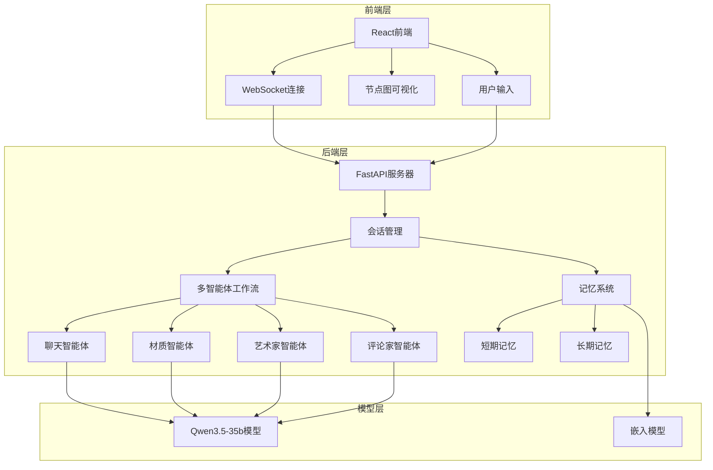

# Blender Node Agent

智能材质节点生成器，使用多智能体架构为 Blender 生成快速材质节点图。

## 项目概述

Blender Node Agent 是一个基于 Qianwen语义大模型 的工具，能够根据用户的自然语言描述，自动生成 Blender 材质节点图。它采用了多智能体架构，结合了聊天、材质、艺术家和评论家等多个专业智能体，提供快速材质效果。

### 核心功能

- 智能材质生成：根据自然语言描述生成复杂的材质节点图
- 多智能体协作：聊天智能体、材质智能体、艺术家智能体和评论家智能体协同工作
- 记忆系统：短期和长期记忆，自动归档和检索
- 一键复制：生成的节点图可直接复制到 Blender 中使用

## 技术架构

### 系统架构



### 技术栈

| 分类   | 技术           | 版本   | 用途       |
| ---- | ------------ | ---- | -------- |
| 后端   | Python       | 3.9+ | 核心逻辑     |
| 后端框架 | FastAPI      | -    | API 服务   |
| 后端框架 | LangChain    | -    | 智能体管理    |
| 后端框架 | LangGraph    | -    | 工作流管理    |
| 前端   | React        | 18+  | 用户界面     |
| 前端   | TypeScript   | -    | 类型安全     |
| 前端   | Tailwind CSS | -    | 样式       |
| 模型   | Qwen3.5-35b  | -    | 核心 AI 模型 |
| 数据库  | SQLite       | -    | 长期记忆存储   |

## 项目结构

```
BlenderNodeAgent_Building/
├── Blender_addon/          # Blender 插件
├── backend/                # 后端代码
│   ├── api/                # API 端点
│   ├── data/               # 数据文件
│   │   ├── prompts/        # 提示词模板
│   │   ├── blender_nodes_db.json  # 节点数据库
│   │   └── memory.db       # 记忆数据库
│   ├── internal/           # 内部模块
│   │   ├── config/         # 配置
│   │   ├── memory/         # 记忆系统
│   │   └── utils/          # 工具函数
│   ├── models/             # 数据模型
│   ├── services/           # 服务
│   │   ├── artist_agent/   # 艺术家智能体
│   │   ├── chat_agent/     # 聊天智能体
│   │   ├── critic_agent/   # 评论家智能体
│   │   ├── material_agent/ # 材质智能体
│   │   └── workflow/       # 工作流管理
│   ├── tools/              # 工具
│   ├── app.py              # 主应用
│   └── requirements.txt    # 依赖
├── backups/                # 备份文件
├── frontend/               # 前端代码
│   ├── public/             # 静态文件
│   ├── src/                # 源代码
│   │   ├── components/     # 组件
│   │   ├── hooks/          # 钩子
│   │   ├── services/       # 服务
│   │   └── utils/          # 工具函数
│   └── package.json        # 前端依赖
├── output/                 # 输出文件
└── .env                    # 环境变量
```

## 快速开始

### 前置要求

- Python 3.9+
- Node.js 16+
- Blender 3.0+ (使用生成的节点图)
- 阿里云 DashScope API Key (用于 Qwen 模型)

### 安装步骤

1. **克隆项目**

```bash
git clone <repository-url>
cd BlenderNodeAgent_Building
```

1. **配置环境变量**

在项目根目录创建 `.env` 文件：

```env
# 阿里云 DashScope API Key
DASHSCOPE_API_KEY=your_api_key_here

# 服务器配置
SERVER_HOST=0.0.0.0
SERVER_PORT=8000

# 记忆系统配置
MAX_SHORT_TERM_TURNS=5
MAX_SHORT_TERM_TOKENS=8000
LONG_TERM_MEMORY_ENABLED=true
```

1. **安装后端依赖**

```bash
cd backend
pip install -r requirements.txt
```

1. **安装前端依赖**

```bash
cd ../frontend
npm install
```

### 运行项目

1. **启动后端服务器**

```bash
cd backend
python app.py
```

1. **启动前端开发服务器**

```bash
cd frontend
npm run dev
```

## 智能体架构

### 1. 聊天智能体 (Chat Agent)

- **功能**：理解用户输入，协调其他智能体
- **职责**：处理用户的自然语言请求，提取关键信息

### 2. 材质智能体 (Material Agent)

- **功能**：生成材质节点图
- **职责**：根据用户需求创建合适的材质节点配置

### 3. 艺术家智能体 (Artist Agent)

- **功能**：优化材质效果
- **职责**：调整参数，增强视觉效果

### 4. 评论家智能体 (Critic Agent)

- **功能**：评估材质效果
- **职责**：检查节点图的合理性，提出改进建议
- （待完善）

## 记忆系统

### 短期记忆

- 存储最近的对话历史
- 限制：最多 5 轮对话或 8000 个 token

### 长期记忆

- 自动归档超过阈值的对话
- 使用向量搜索技术检索相关历史
- 存储在 SQLite 数据库中

## 配置选项

| 配置项                         | 描述                    | 默认值      |
| --------------------------- | --------------------- | -------- |
| DASHSCOPE\_API\_KEY         | 阿里云 DashScope API Key | NOT\_SET |
| SERVER\_HOST                | 服务器主机                 | 0.0.0.0  |
| SERVER\_PORT                | 服务器端口                 | 8000     |
| MAX\_SHORT\_TERM\_TURNS     | 短期记忆最大轮数              | 5        |
| MAX\_SHORT\_TERM\_TOKENS    | 短期记忆最大 token 数        | 8000     |
| LONG\_TERM\_MEMORY\_ENABLED | 是否启用长期记忆              | true     |
| AUTO\_ARCHIVE\_ENABLED      | 是否自动归档                | true     |
| ARCHIVE\_THRESHOLD          | 归档阈值                  | 10       |

## 工具

项目包含多个工具，用于支持智能体的功能：

### 1. 节点知识工具 (node\_knowledge\_tool.py)

- **功能**：查询Blender节点知识库
- **用途**：提供节点信息，帮助智能体生成正确的节点配置

### 2. 物理属性工具 (physical\_properties\_tool.py)

- **功能**：查询材质的物理属性
- **工具列表**：
  - `lookup_material_properties`：查询材质的物理属性（IOR、颜色、金属度等）
  - `search_materials`：按关键词搜索可用的材质
  - `list_material_categories`：列出所有可用的材质分类
  - `extract_and_enrich_materials`：智能分析用户输入，自动检测其中提到的材质名称并注入详细的物理参数

### 3. 艺术家智能体工具 (artist\_agent\_tool.py)

- **功能**：支持艺术家智能体的功能
- **工具列表**：
  - `check_artist_version`：检查艺术家智能体版本
  - 暂时留空等待更新

### 4. Blender文档工具 (blender\_docs.py)

- **功能**：提供Blender相关文档信息
- **用途**：帮助智能体了解Blender的功能和用法

### 5. 评论家智能体工具 (critic\_agent\_tool.py)

- **功能**：支持评论家智能体的功能
- **用途**：帮助评论家智能体评估材质效果

### 工具调用

项目提供了以下工具调用函数：

- `get_Material_tools()`：获取材质相关工具
- `get_chat_tools()`：获取聊天相关工具
- `get_critic_tools()`：获取评论家相关工具
- `get_artist_tools()`：获取艺术家相关工具

这些工具被智能体用来获取信息、生成材质节点图和评估材质效果。

## 未来规划

支持更多材质类型

增加材质预览功能

支持节点图编辑和调整

添加材质库和模板

优化智能体协作效率

WebSocket 实时状态更新和流式响应

<br />

***

Blender Node Agent - 让材质创建变得简单而智能！
